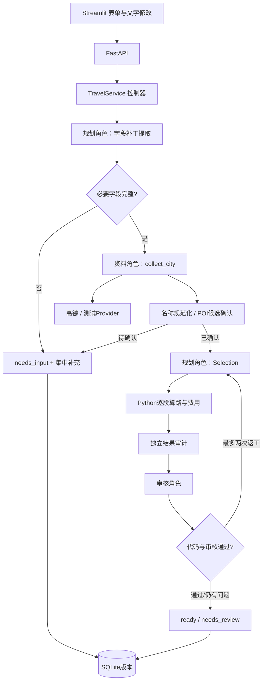

# 技术架构与设计决策

2026-10-31更新；当前验收以[统一摘要](ACCEPTANCE.md)为准。Python 3.12.14、AutoGen AgentChat / Ext 0.7.5、FastAPI、Pydantic v2、HTTPX、SQLite、Streamlit。代码与全部命令在唯一项目目录中维护。

## 模块与调用关系

| 文件 | 职责与阅读重点 |
|---|---|
| `schemas.py` | 输入/输出、约束一致性、字段补丁；禁止多余字段与非有限金额 |
| `input_parser.py` | 离线聊天的有限规则；未识别字段不补默认值 |
| `agents.py` | AutoGen角色运行、工具白名单、JSON结构修复、任务隔离 |
| `model_client.py` | 在每次SDK请求前扣调用额度，含工具反思与格式修复 |
| `providers.py` | HTTP超时、重试、请求内缓存、证据登记与数值规范化 |
| `names.py` | 城市全称规范化、原文映射、POI身份绑定与歧义候选 |
| `adjustments.py` | 具体可选调整及影响，只有显式选择后才应用 |
| `history.py` | 按持久化快照比较约束、每日事件与预算 |
| `planning.py` | POI选择校验、逐段交通、活动时间、预算区间和风险 |
| `audit.py` | 独立重算日期、顺序、时间、重复、来源、数量与金额 |
| `service.py` | 请求生命周期、最多两轮返工、状态与资源回收 |
| `storage.py` | SQLite版本读写、事务与乐观并发保护 |
| `main.py` / `ui.py` | HTTP接口与表单/行程展示，不做业务算术 |

## 三角色与单角色基线

资料角色只能对需求中的城市调用 `collect_city`。目标城市获取地理编码、POI、酒店位置和天气；若出发城不在目的地，只查出发城地理编码，不额外搜索景点。规划角色提取字段补丁并从真实查询到的ID中选每日1～3个地点。审核角色接收需求、具来源的日程与代码检查结果，返回 `approved` 与问题。

Python显式调度，不依赖开放式群聊自动决定结束。每个请求创建独立模型客户端，每次角色运行创建新 `AssistantAgent`，只传必要结构化状态；不会共用跨请求聊天实例。规划→审核是实际运行链路，命名三个对象本身不算协作。

`single`基线由控制器直接查询同一Provider，再运行规划角色；同样执行代码审计与返工，不调用资料/审核模型。`multi`增加资料工具调用与审核模型。对照测量这两个增量是否值得额外耗时和token，不声称实现的是同模型“完全没有工具”基线。

## 字段补丁与修改

AutoGen JSON提取返回 `ConstraintPatch`，未提到的字段必须省略。合并顺序为旧需求→文字补丁→明确结构化changes；创建时显式表单/API字段优先于文字提取。随后重新执行Constraints校验，保留城市、人数、日期与价格区间等未修改字段。规范化validator保留 `model_fields_set`，防止默认空列表错误覆盖文字提取。

仅涉及day_rules/day_place_ids/opening_rules等分日约束时，保留未影响日期的DayPlan与BudgetItem。下午修改保留13:00前结束的事件，再从保存的坐标衔接重算。全局字段变化或旧版没有分日费用标记时扩大重算并解释；所有修改重新审计全团费用。`base_version`必须是最新；旧版可读取或clone为新旅行。失败、待补充或待审核也作为实际新版本保存。

## 硬约束与结果审计

模型决定POI与分配，金额和时间由Python生成。以规范POI ID检查必去/排除、同城归属、来源与重复；名称歧义先保存needs_input，不先给模糊地点算路。用户确认的酒店/车站通过详情核验ID、行政区、类别和坐标，参与实际起终点。每个地点窗口由daily时段、首/末日到离时间和DayRule取交集；OpeningRule只采用明确提供的日期/依据。

坐标邻近排序仅生成一个候选顺序，随后使用同一Provider查询原顺序与候选顺序全部本地交通段，采用耗时较短者。每日至多三个地点，预留后续必要算路额度；开放规则存在、跨城返程或额度不足时不优化。DayPlan记录比较前后时长和交通合计；不求解全局最短路线。

`AdmissionService` 在选择景点后、算路前查询按场馆和日期绑定的入场资料，先处理已知闭馆或售罄，再校验开放窗口、停止入场、用户预约确认和成人基础票价。公开网页只作为数据处理，不交给模型执行指令；未知/过期降级，不猜价格。刷新沿用选择、零模型调用并保存新版本。具体适配范围、时效与接口见 [入场核验](ADMISSION_VERIFICATION.md)。

`audit_result`不调用生成器算术，用Decimal独立重算金额、日期、间夜、人天、POI身份、递增时间、活动窗口、游览时长与开放规则；新增独立核验来源时效、入场窗口、人数/日期绑定的预约确认、基础票价及票价预算行。meal/rest/wait明确显示，单项费用为0，餐饮统一在每日预算计入。新的结果字段均有默认值，旧SQLite JSON可以继续读取；旧数据缺乏分日费用时不做虚假的局部复用。

审核不能清除错误，最多初始草案加两次返工。预算/无障碍/时间不足等确定问题及重复相同错误提前停止；可修复的虚构POI仍走有界返工。adjustments只提供适用的候选changes和影响，revise按持久化的adjustment_id取出并执行，不自动放宽原需求。

## 工具与模型边界

高德接口增加`/v3/place/detail`核验明确选择的地点，其余为地理编码、POI搜索、天气、公交与驾车2.0。公交参数是citycode；保留返回的步行/公交线路和主要站点，未给出的段不补造。路线是查询时参考，未提交指定日期余票请求。工具错误不包含key或原始响应URL。[官方路径规划2.0](https://developer.amap.com/api/webservice/guide/api/newroute)与[POI搜索](https://developer.amap.com/api/webservice/guide/api-advanced/search)为适配依据；2026-10-15广州小样本实际通过的范围见LIVE_ACCEPTANCE，本轮没有重跑真实接口。

高德网络超时12秒，瞬态HTTP429/5xx或网络错误最多重试一次；实际HTTP尝试计入工具预算，缓存命中不计。候选数量最多50/城，优先保留必去地点的精确名称。每个请求缓存路线与查询，返工重复相同路线不重复消耗额度。必要路线、耗时或费用所需距离缺失则失败；天气不可用降级为警告。

默认每请求300秒、300次工具尝试、30次模型请求；工具上限最多500、模型上限最多50，返工上限2，模型输出上限8000 token/次。网页从health读取后端等待上限，额外预留30秒清理与返回，连接等待单独为10秒；超时后引导先检查历史，避免立即重复提交。生产模型客户端禁用SDK自动重试，使请求计数与出站尝试一致。不是全局账户金额熔断器，批量评测应从小样本开始。

默认DeepSeek客户端：OpenAI兼容Chat Completions；非工具输出请求JSON模式，Pydantic执行实际Schema检查，最多一次格式修复。默认关闭思考模式，避免旧SDK丢失多轮 `reasoning_content` 的兼容风险；仍须真实兼容验收。客户端声明支持工具/JSON是配置预期，不是实测证据。

资料工具抛出的业务错误在AutoGen工具边界可能被转换为文本，所以控制器另保留首次失败类型并在资料任务结束后恢复该错误，避免把限流误报为缺资料。全部资源在finally中关闭，回收最多等待3秒；SQLite连接用独立contextmanager显式close，适配Windows文件锁。

## 持久化、并发与日志

单表 `trips(id TEXT, version INTEGER, payload TEXT, PRIMARY KEY(id,version))`，payload是完整业务快照：约束、日程、预算、来源、检查、摘要与用量。读最新版本按version降序；写入 `BEGIN IMMEDIATE` 后检查最新版本与期望版本一致，再插入，防止两个并发修改都成功。连接超时10秒。

历史列表最多读取最近500条最新快照，按城市/日期过滤后默认返回50条；当前是本地个人应用，不是大型历史检索服务。版本API按版本降序；compare对比实际快照，不依赖模型说明。clone创建新ID且不覆盖原旅行。

Trace保留角色名、事件类型、验证代码、工具端点（无query）、尝试次数、耗时、异常类别和使用量。工具原文、原始自由文本、模型thought与API key均不写入trace。SQLite业务状态仍包含用户明确要求的旅行偏好，适用于本机个人演示；生产多用户鉴权、数据删除与审计策略尚未实现。

HTTP输入校验错误不回显非法值；敏感编号/越权请求在模型前阻断，并在保存前清空约束。规则检测不是完备攻击防御；外部资料可信度与模型对指令注入的实际抵抗需要真实模型测试。没有预订、支付、取消或执行代码工具，未知工具名不能获得额外能力。

## 运行与可复现限制

版本锁、离线测试、固定场景hash、离线CI和Docker配置提供复现入口。Windows本地依赖检查、API和UI已验收；Linux/其他Python版本、容器构建、CI云端运行与真实账户配额均未验收。应用默认仅监听127.0.0.1，Compose主机端口也只映射本地。
